# Handleiding Kenniskist

**Voor leerkrachten en ICT'ers, met wat de leerlingen zien**

De plaatjes in deze handleiding komen uit de testomgeving van Kenniskist. Alle namen, klassen en resultaten zijn verzonnen: "Basisschool De Regenboog", "Groep 7a", "Juf Sanne", "Meester Tom" en de leerlingen bestaan niet.

---

## Inhoud

1. [Wat is Kenniskist?](#1-wat-is-kenniskist)
2. [Wie doet wat?](#2-wie-doet-wat)
3. [Inloggen](#3-inloggen)
4. [Voor de ICT'er: de school inrichten](#4-voor-de-icter-de-school-inrichten)
5. [Voor de leerkracht: je klas](#5-voor-de-leerkracht-je-klas)
6. [Een weektaak klaarzetten](#6-een-weektaak-klaarzetten)
7. [De voortgang volgen](#7-de-voortgang-volgen)
8. [Taken en doelen per leerling](#8-taken-en-doelen-per-leerling)
9. [Eén leerling bekijken](#9-een-leerling-bekijken)
10. [Weekoverzicht, werkblad en eigen oefeningen](#10-weekoverzicht-werkblad-en-eigen-oefeningen)
11. [Leerlingen en spelletjes](#11-leerlingen-en-spelletjes)
12. [Wat de leerling doet](#12-wat-de-leerling-doet)
13. [Vrij oefenen](#13-vrij-oefenen)
14. [Munten en briefgeld](#14-munten-en-briefgeld)
15. [De winkel en de lootboxen](#15-de-winkel-en-de-lootboxen)
16. [De kledingkast en samen spelen](#16-de-kledingkast-en-samen-spelen)
17. [Veelgestelde vragen](#17-veelgestelde-vragen)
18. [Uitlegfilmpjes](#18-uitlegfilmpjes)

---

## 1. Wat is Kenniskist?

Kenniskist is een oefenomgeving voor groep 4 tot en met 8. Leerlingen oefenen taal, spelling, rekenen, begrijpend lezen, lezen en topografie. Na een aantal goede antwoorden krijgen ze een kort spelletje als beloning, en met hun antwoorden verdienen ze munten en briefgeld voor hun poppetje.

Als leerkracht zet je klaar wat de leerlingen moeten oefenen:

- **Weektaak:** opdrachten voor de hele klas, voor een paar dagen.
- **Taken:** een losse opdracht voor één of een paar leerlingen.
- **Doelen:** een leerdoel per leerling, dat pas behaald is als het echt goed gaat.

Daarna zie je per leerling wat er gemaakt is, hoeveel er goed ging en waar het nog misgaat.

---

## 2. Wie doet wat?

| Rol | Wat kan diegene? |
|---|---|
| **ICT'er** | Klassen aanmaken, leerkrachten toevoegen en aan klassen koppelen, klasinstellingen beheren, leerlingen doorschuiven naar een nieuw schooljaar. Een ICT'er ziet alle klassen van de school en kan alles wat een leerkracht ook kan. |
| **Leerkracht** | Leerlingen toevoegen, weektaken, taken en doelen klaarzetten, resultaten bekijken, werkbladen printen en eigen oefeningen maken. Een leerkracht ziet alleen de klassen waaraan hij of zij gekoppeld is. |
| **Leerling** | Inloggen met de klascode, oefenen, de weektaak maken, aan doelen werken en spelletjes spelen. Leerlingen maken nooit zelf een account aan. |

---

## 3. Inloggen

Op de voorpagina kies je **Leerkracht** of **Leerling**. Je kunt ook rechtstreeks naar het juiste portaal gaan:

- Leerkrachten en ICT'ers: **kenniskist.nl/leerkrachtenportaal**
- Leerlingen: **kenniskist.nl/leerlingportaal**

### Leerkracht en ICT'er

Je logt in met je e-mailadres en wachtwoord. Ben je je wachtwoord vergeten? Klik dan op **Wachtwoord vergeten** onder het inlogvak. Je krijgt een mail waarmee je een nieuw wachtwoord kiest.

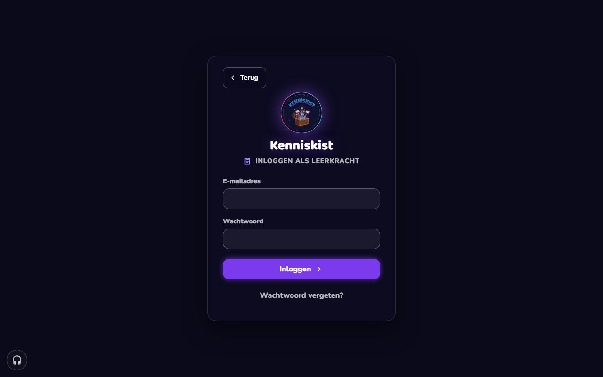

### Leerling

Een leerling vult drie dingen in: de **klascode** (de inlogcode van de klas, bijvoorbeeld `zon7a`), de **gebruikersnaam** en het **wachtwoord**. Die gegevens krijgt de leerling van de leerkracht.

Met **Oefenen zonder account** kan een kind ook zonder inloggen oefenen. Er wordt dan niets bewaard en de leerkracht ziet er niets van terug.

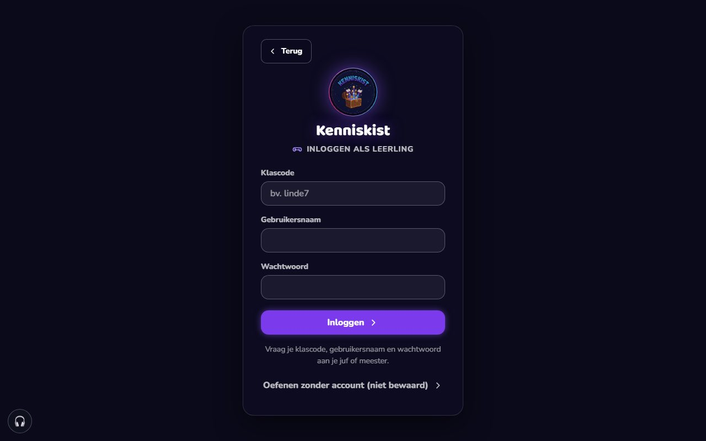

---

## 4. Voor de ICT'er: de school inrichten

### 4.1 Het overzicht

Na het inloggen zie je alle klassen van de school. Op elke klaskaart staat:

- het aantal leerlingen,
- de inlogcode van de klas (het sleuteltje),
- de leeftijdsgroep,
- het schooljaar,
- de leerkracht.

Onderaan staan drie knoppen: **+ Leerling**, **+ Leerkracht** en **+ Klas**. Met het tandwiel rechtsboven op een klaskaart open je de instellingen van die klas.

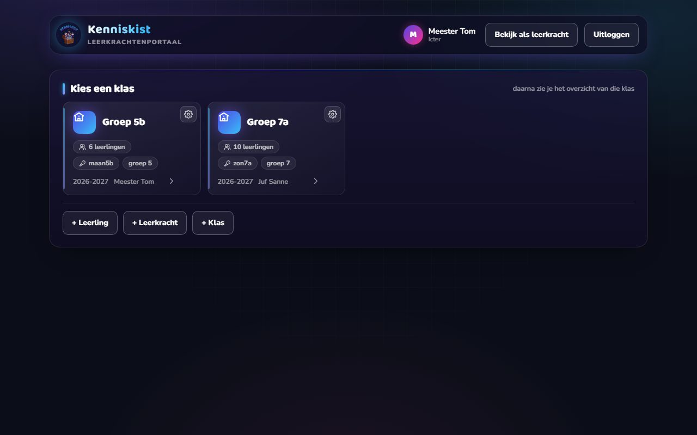

> **Tip:** geef je zelf ook les? Met **Bekijk als leerkracht** (bovenaan) zie je het portaal zoals een leerkracht het ziet. De knoppen voor de ICT'er verdwijnen dan even uit beeld.

### 4.2 Een klas aanmaken

Klik op **+ Klas** en vul in:

- **Naam:** bijvoorbeeld "Groep 7a".
- **Schooljaar:** bijvoorbeeld "2026-2027".
- **Klascode:** dit is de inlogcode voor de leerlingen, dus kies iets korts en makkelijks, zoals `zon7a`. Elke klas heeft een eigen code.
- **Leeftijdsgroepen:** vink de groep(en) van de klas aan. Bij het klaarzetten van een weektaak ziet de leerkracht dan meteen de oefeningen die bij die groep horen. Vink je niets aan, dan ziet de leerkracht alles.

Klik daarna op **Aanmaken**.

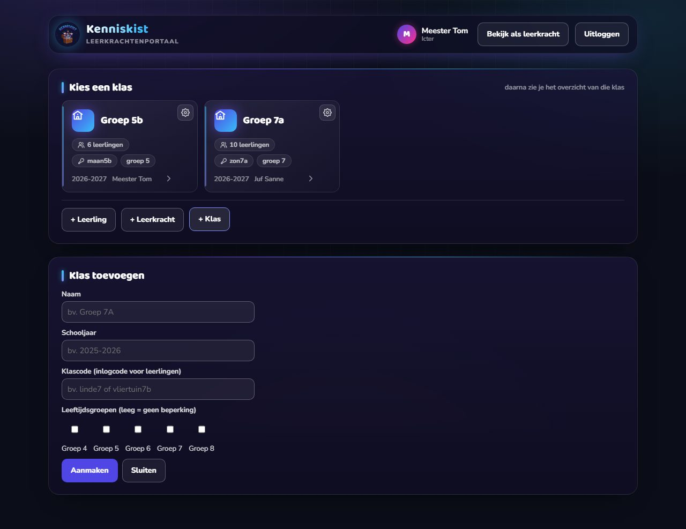

### 4.3 Een leerkracht toevoegen

Klik op **+ Leerkracht** en vul de voornaam, de eerste letter van de achternaam, het e-mailadres en een wachtwoord in. De leerkracht logt daarna in met dat e-mailadres en wachtwoord, en kan het wachtwoord later zelf veranderen via **Wachtwoord vergeten**.

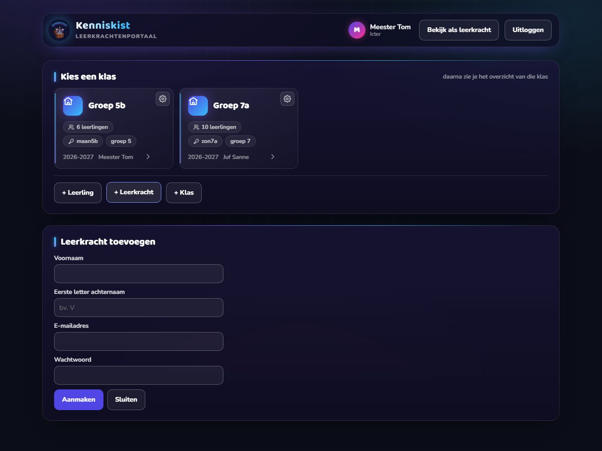

Een nieuwe leerkracht ziet nog geen klassen. Koppel de leerkracht daarom aan een klas in de klasinstellingen (zie hieronder).

### 4.4 De instellingen van een klas

Klik op het **tandwiel** op een klaskaart. Je ziet dan van boven naar beneden:

- **Gegevens van de klas:** naam, schooljaar, inlogcode en leeftijdsgroepen. Verander je de inlogcode, dan moeten de leerlingen voortaan de nieuwe code gebruiken. Vergeet niet op **Wijzigingen opslaan** te klikken.
- **Leerlingen doorschuiven:** aan het eind van het schooljaar. Maak eerst de nieuwe klas aan, kies die hier en klik op **Doorschuiven**. Het gemaakte werk en de munten van de leerlingen gaan gewoon mee; alleen de klas verandert.
- **Leerkrachten van deze klas:** kies een leerkracht en klik op **Koppelen**. Alleen gekoppelde leerkrachten zien de klas, de leerlingen en hun resultaten. Met het rode kruisje haal je een koppeling weg.
- **Gemaakt werk wissen:** wist de opgaven, fouten en sessies van de hele klas, bijvoorbeeld aan het begin van een nieuw blok. Weektaken, taken en doelen blijven staan.
- **Voorlezen:** vink de leerlingen aan die bij begrijpend lezen een luidsprekerknop krijgen, zodat ze de tekst en de vragen kunnen laten voorlezen.
- **Leerlingen:** met het rode kruisje verwijder je een leerling.
- **Klas verwijderen:** kan alleen als er geen leerlingen meer in de klas zitten. Schuif ze dus eerst door.

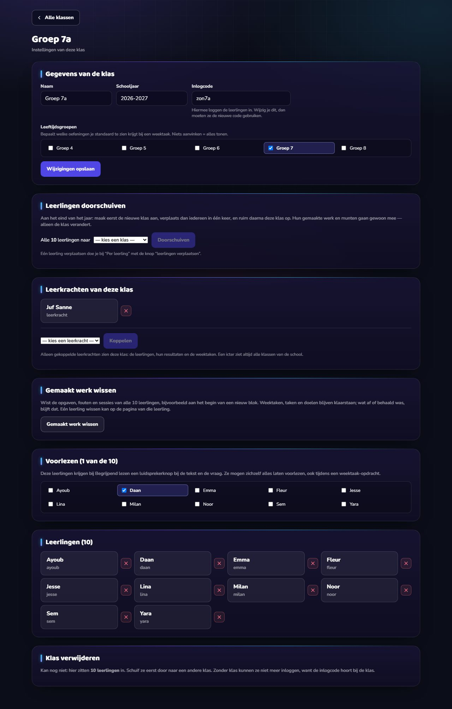

---

## 5. Voor de leerkracht: je klas

### 5.1 Je klassen

Na het inloggen zie je de klassen waaraan je gekoppeld bent. Klik op een klas om hem te openen.

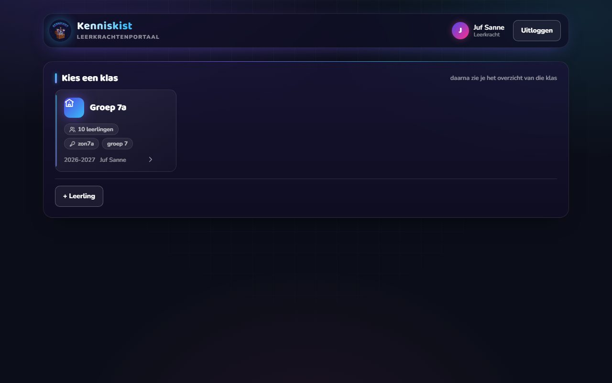

### 5.2 Leerlingen toevoegen

Klik op **+ Leerling** en vul in:

- **Voornaam** en **eerste letter van de achternaam:** dit is wat jij in het portaal ziet.
- **Gebruikersnaam:** hiermee logt de leerling in. Kies iets eenvoudigs, bijvoorbeeld de voornaam in kleine letters.
- **Wachtwoord:** kies een wachtwoord dat een kind kan onthouden.
- **Klas:** de klas waar de leerling in komt.

Klik op **Aanmaken**. Geef de leerling daarna de drie inloggegevens: de **klascode**, de **gebruikersnaam** en het **wachtwoord**.

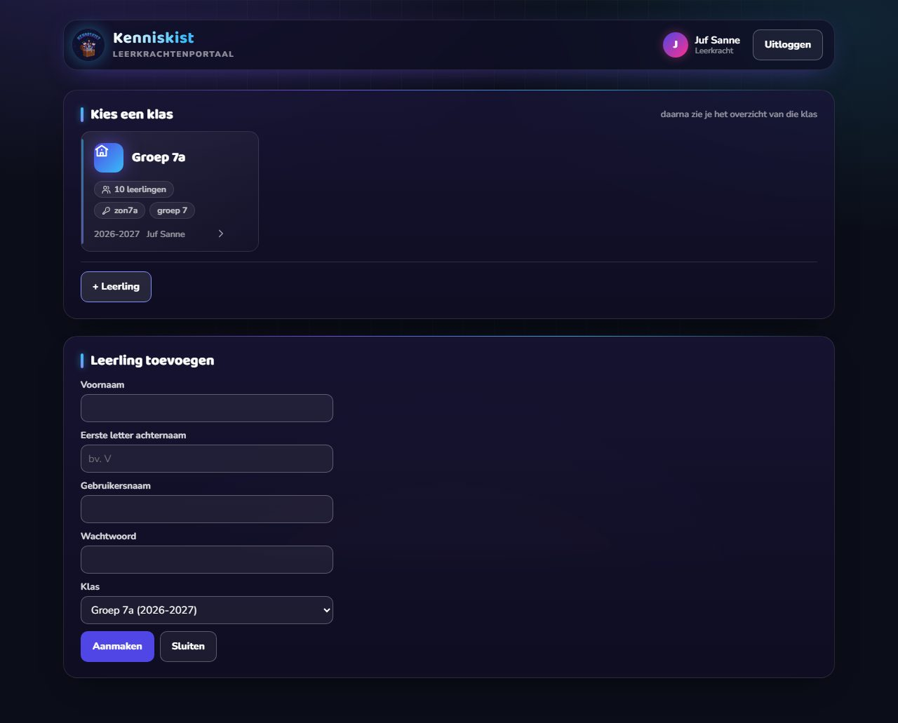

### 5.3 Het klasscherm

Bovenaan zie je de naam van de klas, het aantal leerlingen en de **inlogcode** (hier `zon7a`). Daaronder staan de tabbladen:

| Tabblad | Waarvoor? |
|---|---|
| **Weektaak** | Opdrachten voor de hele klas, met een begin- en einddatum. |
| **Taken** | Losse opdrachten voor één of een paar leerlingen. |
| **Doelen** | Leerdoelen per leerling. |
| **Weekoverzicht** | Wat een leerling per week heeft gedaan. |
| **Werkblad** | Een werkblad om te printen. |
| **Eigen oefeningen** | Oefeningen met je eigen vragen. |
| **Leerlingen** | Je leerlingen, en hoe vaak er een spelletje komt. |

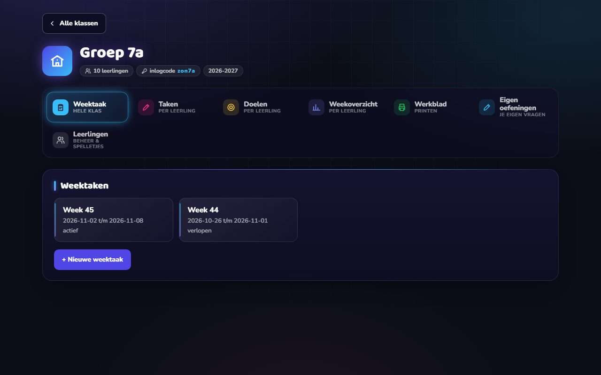

---

## 6. Een weektaak klaarzetten

Ga naar het tabblad **Weektaak** en klik op **+ Nieuwe weektaak**. Je doorloopt vier stappen.

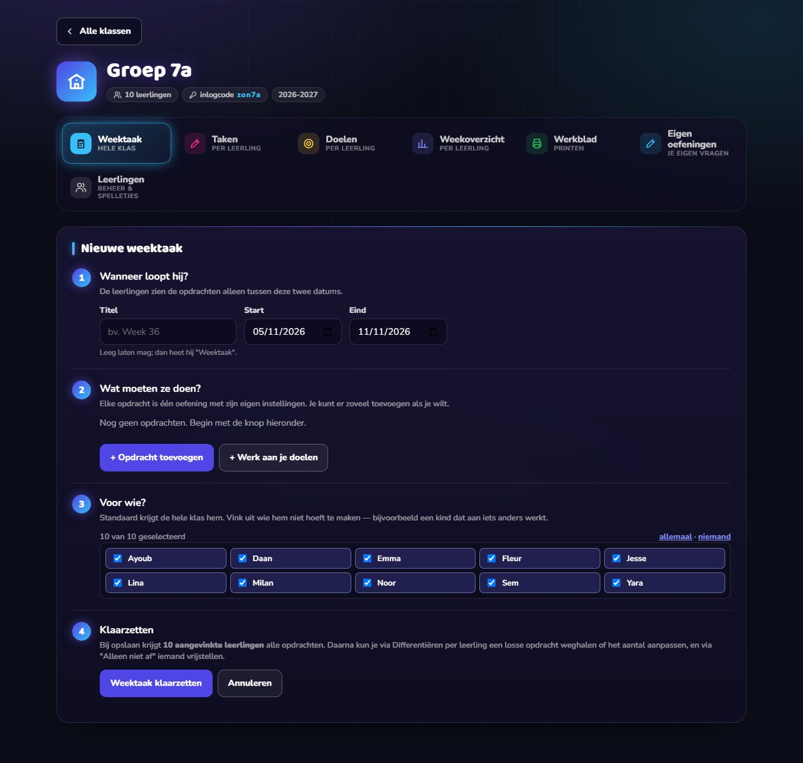

### Stap 1: Wanneer loopt hij?

Geef de weektaak een titel (bijvoorbeeld "Week 46") en kies de **start**- en **einddatum**. De leerlingen zien de opdrachten alleen tussen die twee datums.

### Stap 2: Wat moeten ze doen?

Klik op **+ Opdracht toevoegen**. Kies eerst het **vak**:

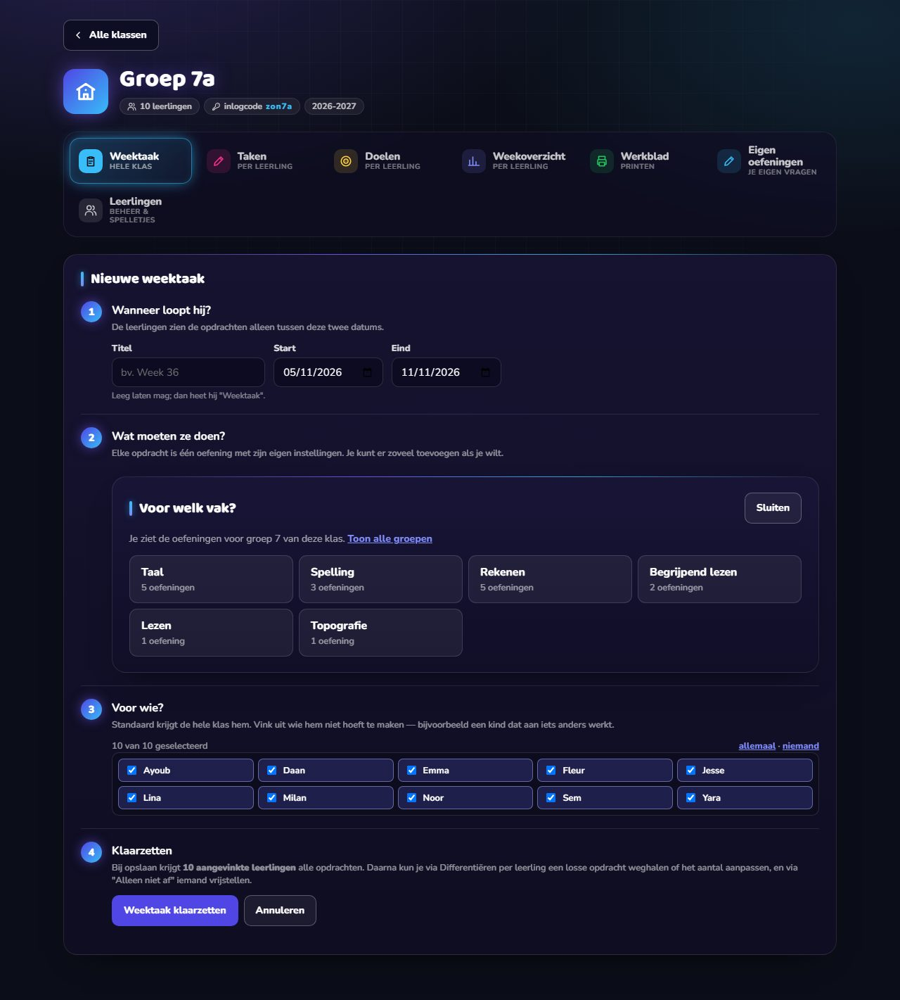

En daarna de **oefening**. Bij elke oefening staat voor welke groepen hij is en hoeveel opgaven hij standaard heeft.

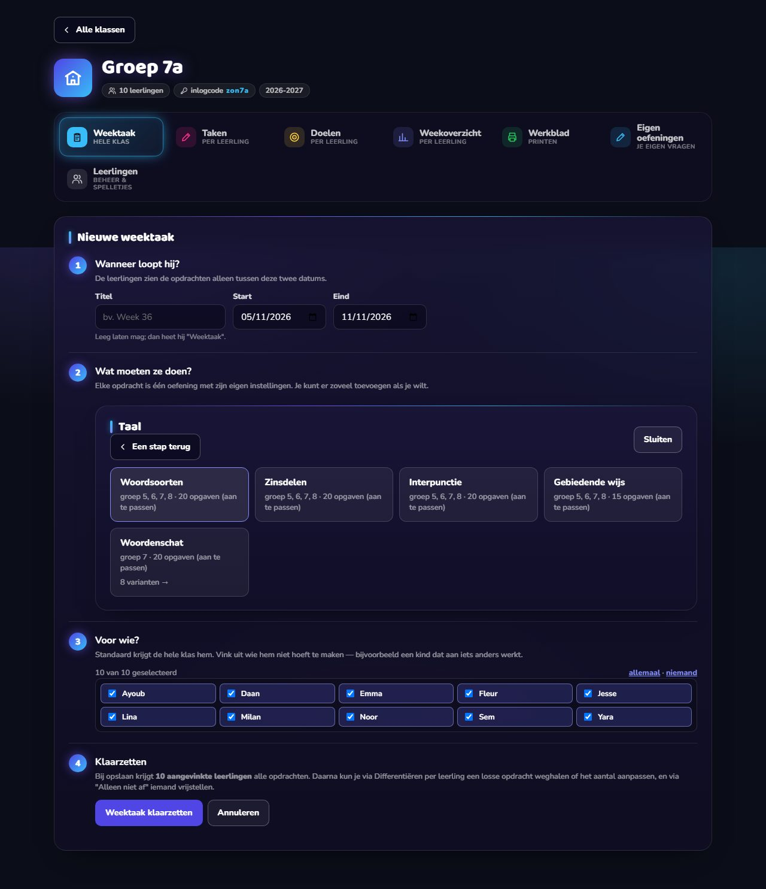

Elke opdracht verschijnt daarna als blok met zijn eigen instellingen. Bij **Woordsoorten** kies je bijvoorbeeld het aantal opgaven en welke woordsoorten erin zitten. Je kunt ook fijnere soorten kiezen, zoals hulpwerkwoord, voltooid deelwoord, en persoonlijk en bezittelijk voornaamwoord. Een rode melding laat zien wat er nog ontbreekt, bijvoorbeeld "Kies er minstens 2".

Je kunt zoveel opdrachten toevoegen als je wilt. Met **Verwijderen** haal je er een weg.

**Werk aan je doelen:** met deze knop voeg je een opdracht toe waarbij de leerling een ingesteld aantal minuten aan zijn eigen doelen werkt (zie [hoofdstuk 8](#8-taken-en-doelen-per-leerling)). Alleen echte oefentijd telt mee, spelletjes niet. Heeft een leerling al zijn doelen behaald, dan kiest hij zelf wat hij oefent.

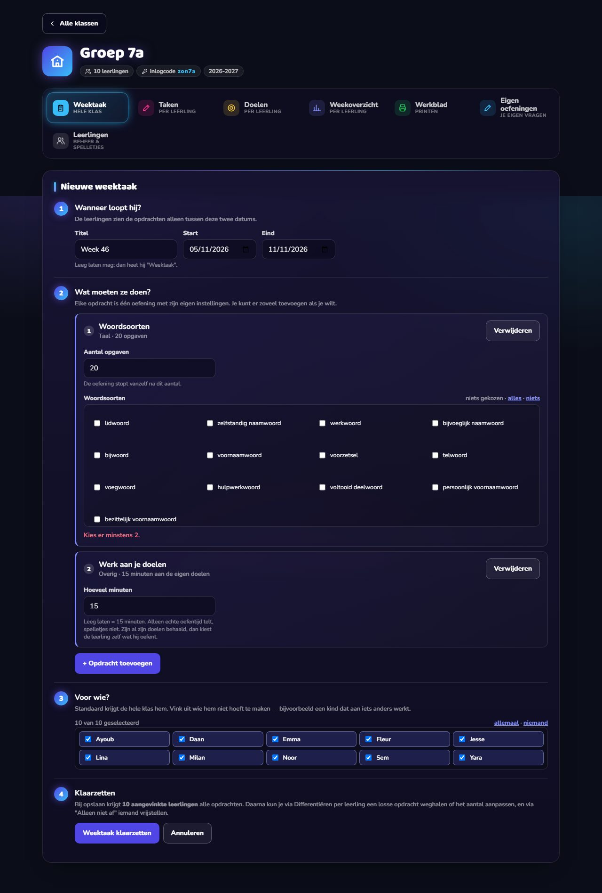

### Stap 3: Voor wie?

Standaard krijgt de hele klas de weektaak. Vink uit wie hem niet hoeft te maken, bijvoorbeeld een kind dat aan iets anders werkt. Met **allemaal** en **niemand** zet je alles in één keer aan of uit.

### Stap 4: Klaarzetten

Klik op **Weektaak klaarzetten**. Vanaf de startdatum zien de leerlingen de opdrachten bij **Mijn weektaak**.

> **Tip:** wil je volgende week bijna hetzelfde? Open een bestaande weektaak en klik op **Kopiëren**. Je hoeft dan alleen de datums en wat je anders wilt aan te passen.

---

## 7. De voortgang volgen

Klik op een weektaak (bijvoorbeeld "Week 45"). Je ziet dan een tabel met per leerling per opdracht hoe ver hij is.

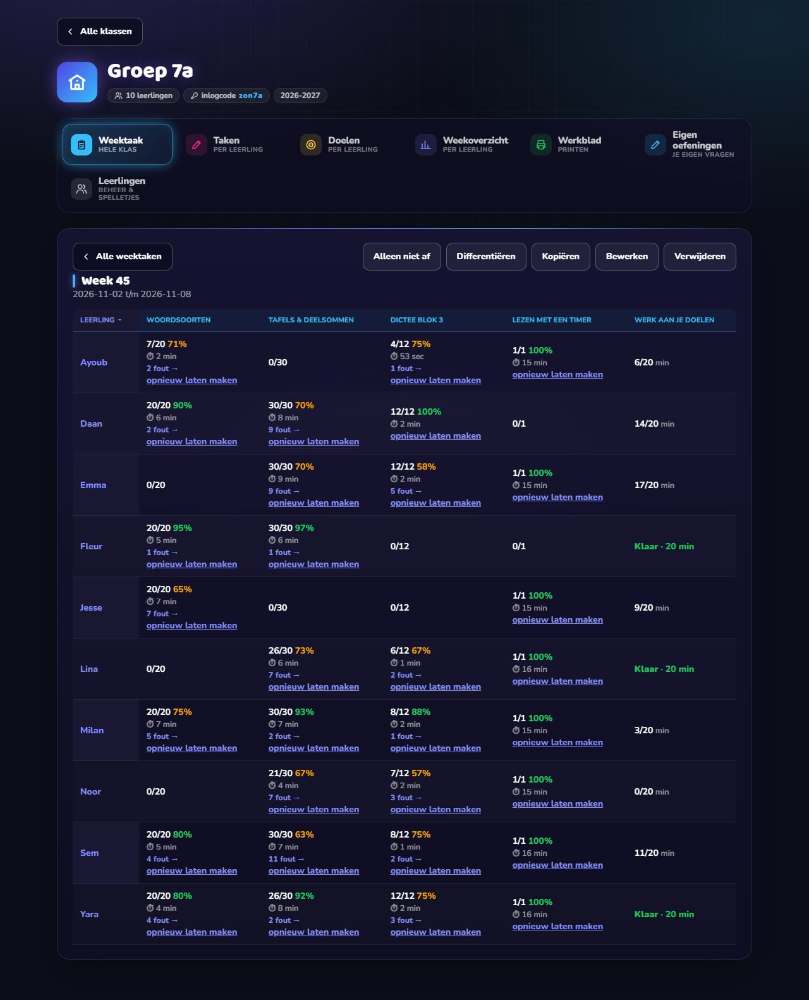

Zo lees je een vakje:

- **7/20:** zeven van de twintig opgaven gemaakt.
- **71%:** het percentage goed. Groen is goed, oranje gaat redelijk, rood vraagt aandacht.
- **⏱ 2 min:** zoveel tijd heeft de leerling eraan besteed (alleen oefentijd, geen spelletjes).
- **2 fout →:** klik hierop om de foutenlijst van die leerling te openen.
- **opnieuw laten maken:** zet de teller weer op 0, zodat de leerling de opdracht opnieuw maakt. Het werk dat al gemaakt is, blijft bewaard.
- **Klaar · 20 min:** bij "Werk aan je doelen" heeft de leerling zijn minuten gehaald.

Haalt een leerling minder dan de helft goed, dan zet Kenniskist de opdracht vanzelf opnieuw klaar. In het vakje staat dan "poging 2".

Klik op een **kolomkop** om de tabel te sorteren: wie het minst af heeft, staat dan bovenaan.

### Knoppen boven de tabel

- **Alleen niet af:** een lijst van alles wat nog openstaat, per leerling. Hier kun je een opdracht op "hoeft niet" zetten. Hij telt dan niet meer mee als achterstand.
- **Differentiëren:** per leerling aangeven welke opdrachten hij krijgt en hoeveel opgaven (zie hieronder).
- **Kopiëren:** maak een nieuwe weektaak op basis van deze.
- **Bewerken:** verander de titel, de datums of de opdrachten.
- **Verwijderen:** haal de weektaak weg.

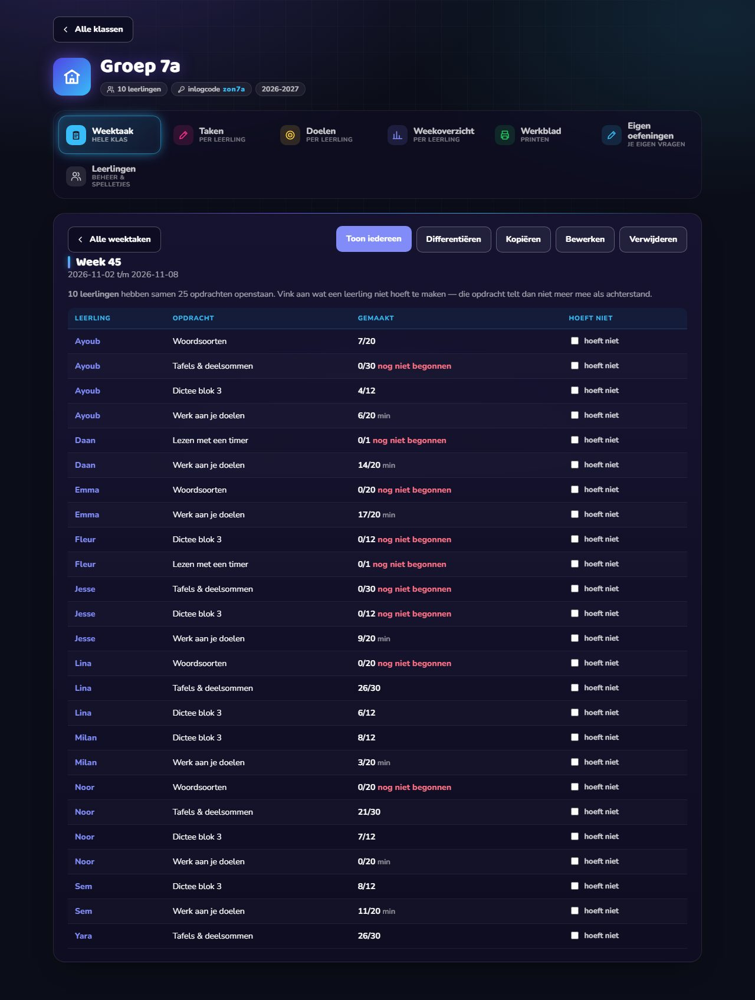

### Differentiëren

Bij **Differentiëren** vink je per leerling aan welke opdrachten hij krijgt, en vul je eventueel een eigen aantal opgaven in. Een sterke rekenaar kan zo bijvoorbeeld 40 sommen krijgen en een kind dat moeite heeft 15. Met **alles aan/uit** zet je een hele kolom in één keer aan of uit. Klik op **Opslaan** als je klaar bent.

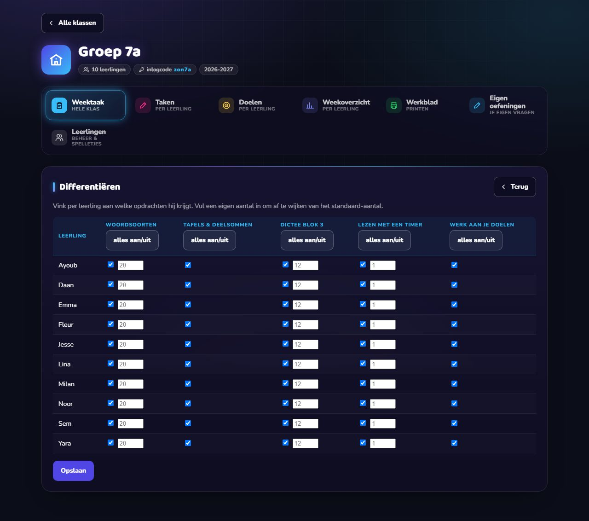

---

## 8. Taken en doelen per leerling

### Taken

Een **taak** is een opdracht voor één of een paar leerlingen, bijvoorbeeld "Extra oefenen: breuken". De taak blijft staan tot de leerling hem af heeft. De leerling vindt hem bij **Speciaal voor mij → Taken**.

Ga naar het tabblad **Taken** en klik op **+ Nieuwe taak**. Je vult hetzelfde in als bij een weektaak, maar bij **Voor wie?** staat standaard niemand aangevinkt: vink zelf de leerlingen aan.

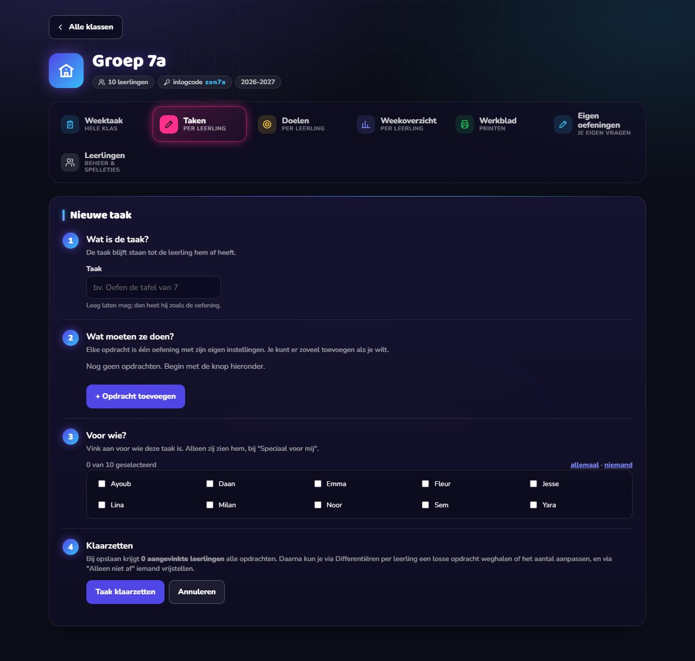

### Doelen

Een **doel** is een leerdoel, bijvoorbeeld "Komma bij opsommingen" of "Tafels van 6, 7 en 8". Een doel heeft geen vast aantal opgaven. Het is **behaald als de leerling van zijn laatste 20 opgaven er minstens 80% goed heeft**. Een behaald doel blijft behaald, ook als het daarna een keer misgaat. Het doel blijft staan tot jij het verwijdert.

Op het tabblad **Doelen** zie je alle doelen van de klas, voor wie ze zijn en hoeveel leerlingen het doel al behaald hebben.

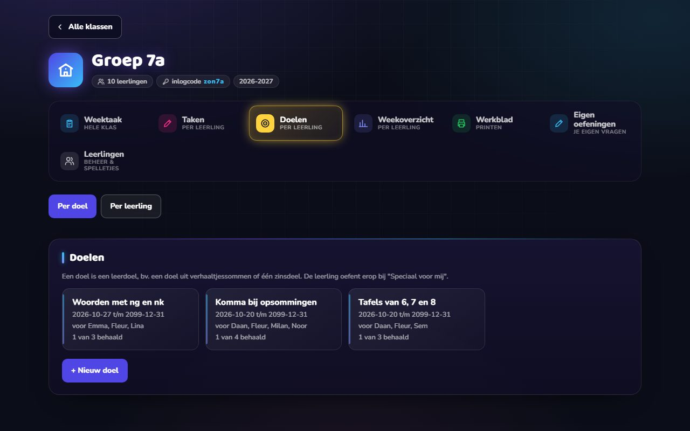

Klik op **+ Nieuw doel**:

1. **Wat is het doel?** Geef het doel een naam. Laat je dit leeg, dan krijgt het de naam van het doel dat je bij stap 2 kiest.
2. **Waarmee oefenen ze het doel?** Kies een vak en daarna het doel, bijvoorbeeld Taal → Interpunctie → Komma's. Staat het doel er niet bij? Klik dan op **Kies zelf een oefening**.
3. **Voor wie?** Vink de leerlingen aan.
4. Klik op **Doel klaarzetten**.

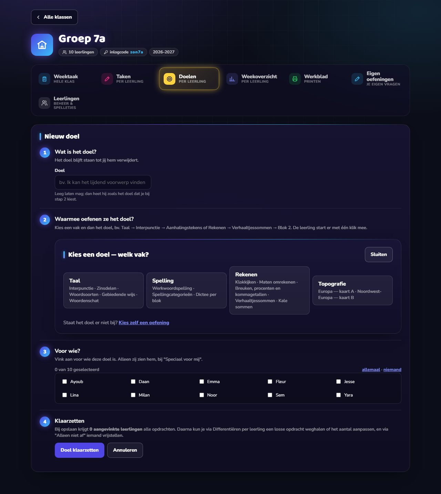

Klik op een doel om per leerling de stand te zien:

- **6/20 gemaakt:** de leerling heeft nog geen 20 opgaven gemaakt.
- **90% laatste 20 · nodig 80%:** van de laatste 20 opgaven was 90% goed.
- **Gehaald:** het doel is behaald.

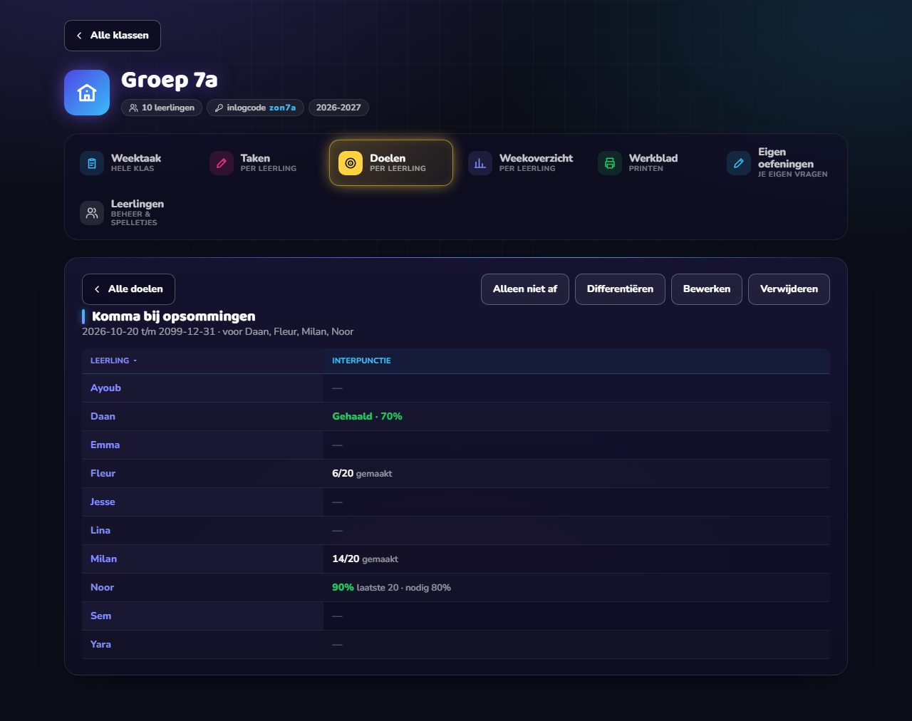

Met **Per leerling** (bovenaan het tabblad) zie je juist per kind alle doelen bij elkaar.

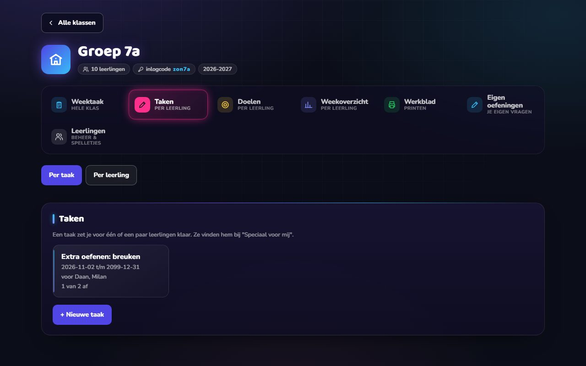

---

## 9. Eén leerling bekijken

Klik in een tabel op de **naam** van een leerling. Je ziet dan:

- hoe de leerling inlogt (klascode en gebruikersnaam),
- hoeveel opgaven er gemaakt zijn, hoeveel procent goed, hoeveel fout en wanneer de leerling voor het laatst actief was,
- **Waar zit het in? (foutanalyse):** per onderdeel hoeveel er goed ging. De zwakste plek staat bovenaan.
- **Wat ging er precies fout?** De foute antwoorden, met het goede antwoord erbij.
- **Per oefening** en **Wat is er gemaakt? (alle sessies)**.

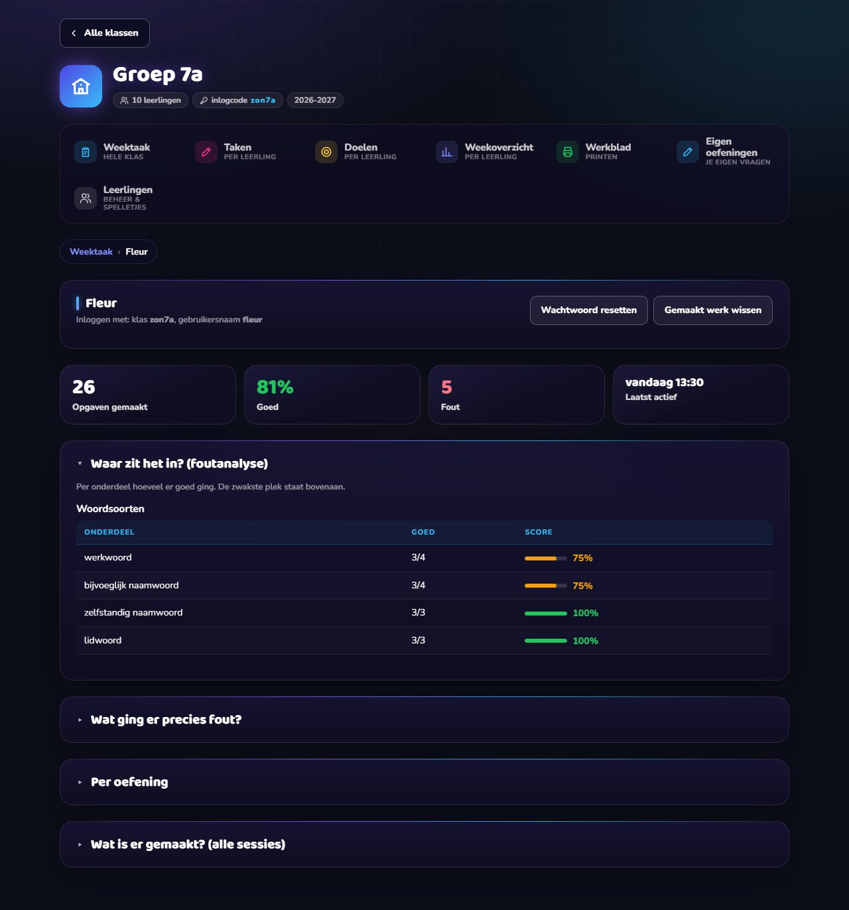

### Wachtwoord vergeten

Een leerling die zijn wachtwoord kwijt is, kan dat niet zelf herstellen. Open de leerling, klik op **Wachtwoord resetten**, typ een nieuw wachtwoord en klik op **Opslaan**. Geef het nieuwe wachtwoord aan de leerling.

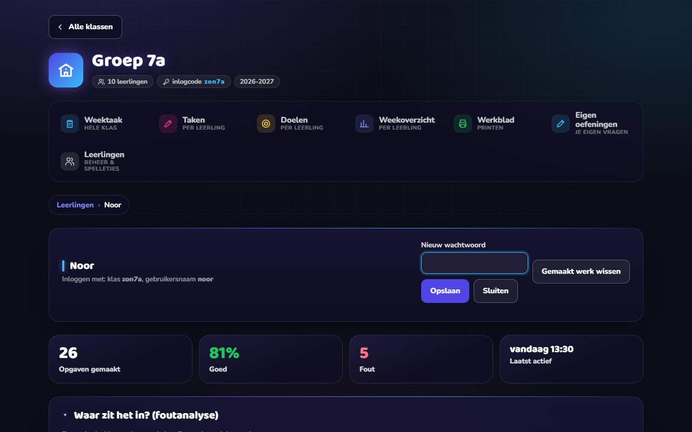

Met **Gemaakt werk wissen** wis je het gemaakte werk van alleen deze leerling.

---

## 10. Weekoverzicht, werkblad en eigen oefeningen

### Weekoverzicht

Op het tabblad **Weekoverzicht** kies je een leerling. Je ziet dan per week, of per dag, wat de leerling heeft gedaan: de weektaak, taken, doelen en vrij oefenen. Bovenaan staan het aantal opgaven, het percentage goed, de minuten oefentijd en het aantal behaalde doelen. Met **Vorige week** blader je terug.

Dit is precies hetzelfde overzicht dat de leerling zelf ziet bij **Mijn week**. Handig voor een gesprekje met de leerling of met ouders.

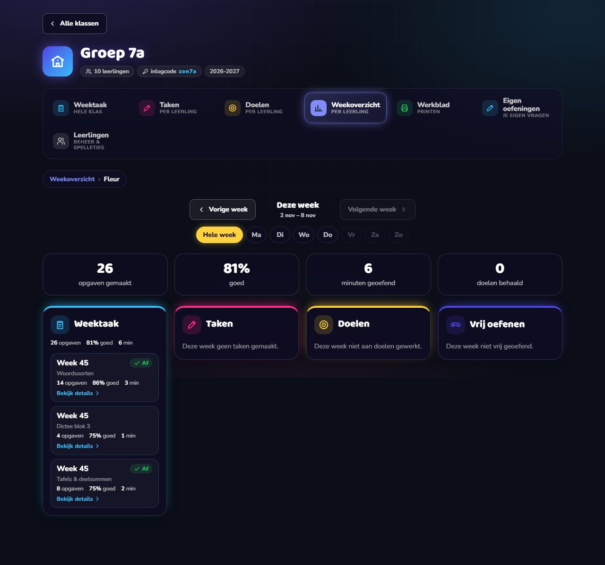

### Werkblad

Op het tabblad **Werkblad** maak je een werkblad op papier. Geef het een titel en kies de doelen per vak. Vink je meerdere onderdelen aan, dan verdeelt het werkblad de opgaven eerlijk. De opgaven komen uit dezelfde oefeningen als op de iPad, en zijn elke keer nieuw. Klokkijken, topografie en het dictee kunnen niet op papier.

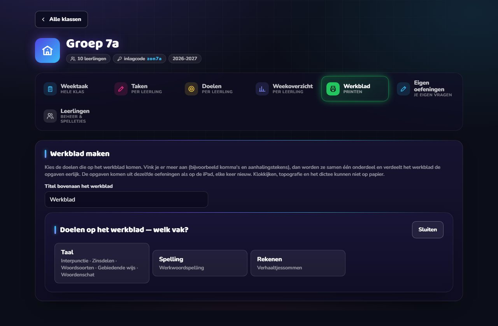

### Eigen oefeningen

Op het tabblad **Eigen oefeningen** maak je een oefening met je eigen vragen, bijvoorbeeld de woorden van het thema of spreekwoorden. Je kiest zelf onder welke groep en welk vak hij komt te staan. Je leerlingen vinden hem bij **Speel Game**, tussen de andere oefeningen van dat vak.

- Geef je bij een vraag ook foute antwoorden op, dan wordt het een meerkeuzevraag. Zonder foute antwoorden typt de leerling het antwoord zelf.
- Je kunt instellen na hoeveel goede antwoorden er een spelletje komt, en hoeveel briefgeld de leerling krijgt als hij alle vragen gemaakt heeft.

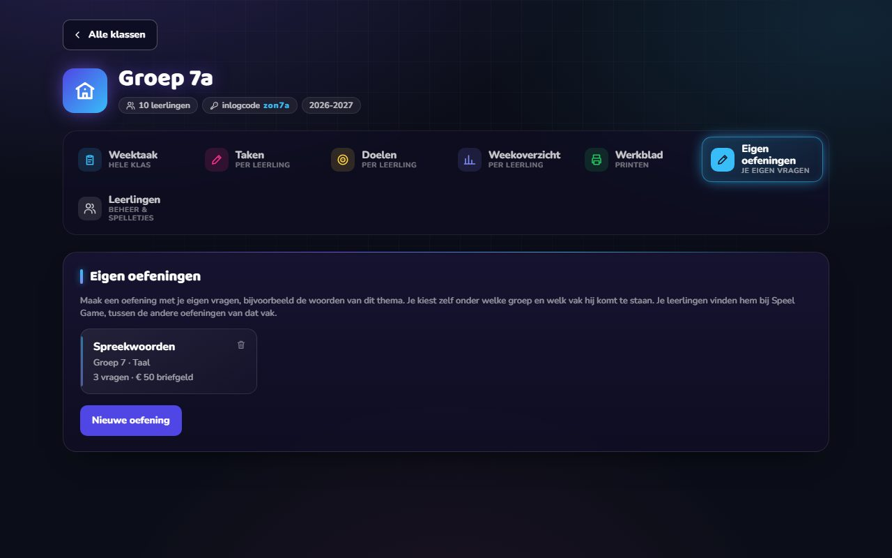

---

## 11. Leerlingen en spelletjes

Op het tabblad **Leerlingen** staan al je leerlingen met hun gebruikersnaam. Klik op een leerling om hem te bekijken (zie [hoofdstuk 9](#9-een-leerling-bekijken)).

Bovenaan stel je in **na hoeveel goede antwoorden** de leerlingen een spelletje krijgen. Standaard is dat na 10 goede antwoorden; bij verhaaltjessommen na 5. Je kunt ook kiezen voor vaker, minder vaak of helemaal geen spelletjes. Leerlingen zien de nieuwe instelling zodra ze opnieuw inloggen of de pagina herladen.

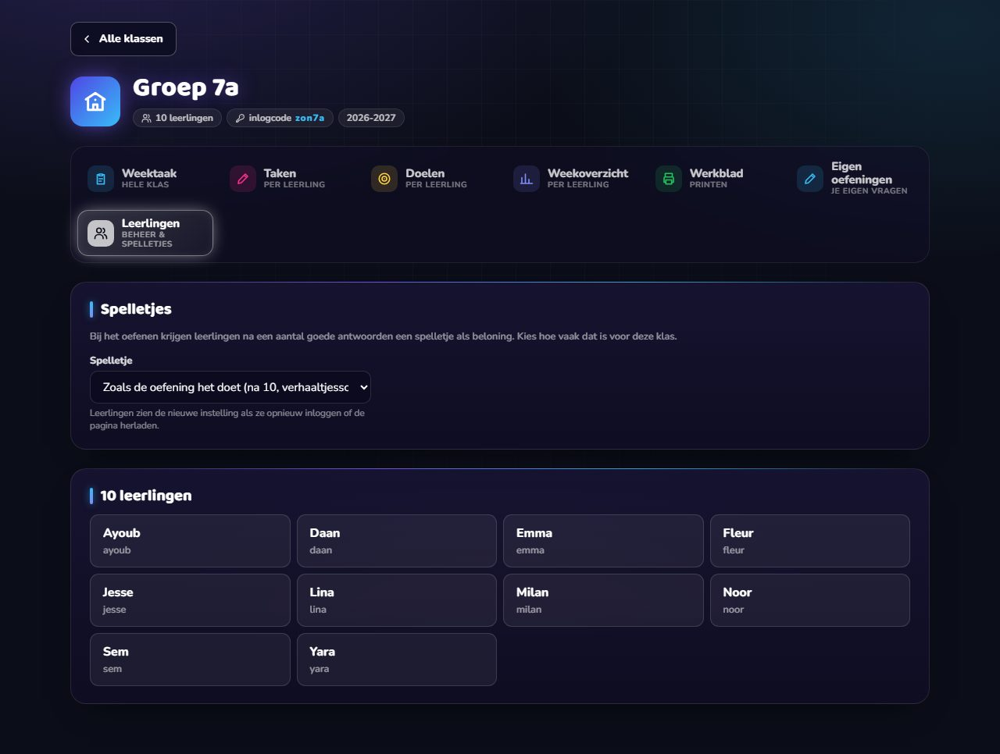

---

## 12. Wat de leerling doet

De leerling werkt meestal op een iPad of Chromebook. Laat de leerlingen op een gedeeld apparaat altijd **uitloggen** als ze klaar zijn (rechtsboven).

### 12.1 Het startscherm

Na het inloggen ziet de leerling:

- **Speciaal voor mij:** de taken en doelen die de leerkracht alleen voor deze leerling heeft klaargezet.
- **Speel Game:** zelf oefenen per groep en vak, en vrij spelletjes spelen.
- **Kledingkast** en **Winkel:** het poppetje aankleden en kleding kopen met munten en briefgeld.
- **Mijn weektaak:** de opdrachten van deze week voor de hele klas.
- **Mijn week:** wat de leerling deze week gedaan heeft.
- **Code invoeren** (linksonder): een code van de leerkracht invoeren, bijvoorbeeld voor een extra opdracht of spel. Met de koptelefoon zet de leerling de muziek aan of uit.

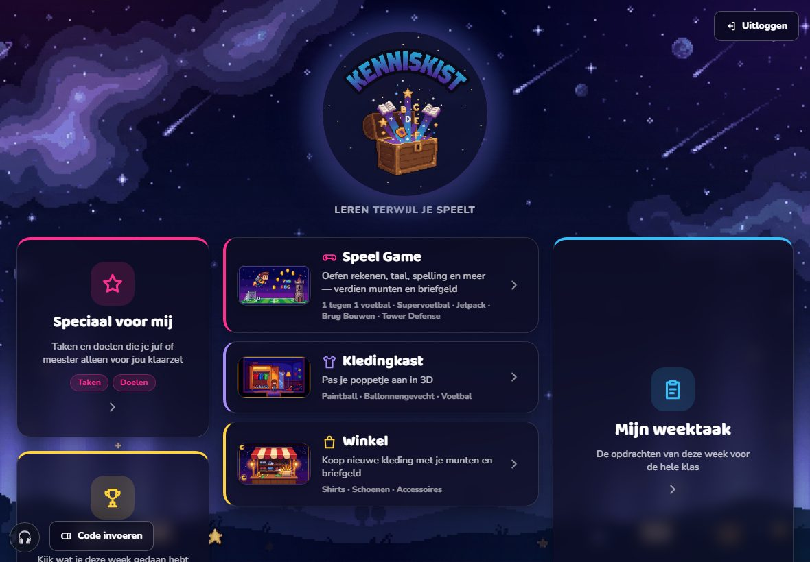

### 12.2 Mijn weektaak

De leerling tikt op **Mijn weektaak** en ziet de weektaken die nu lopen, met hoeveel er al af is en tot wanneer hij loopt.

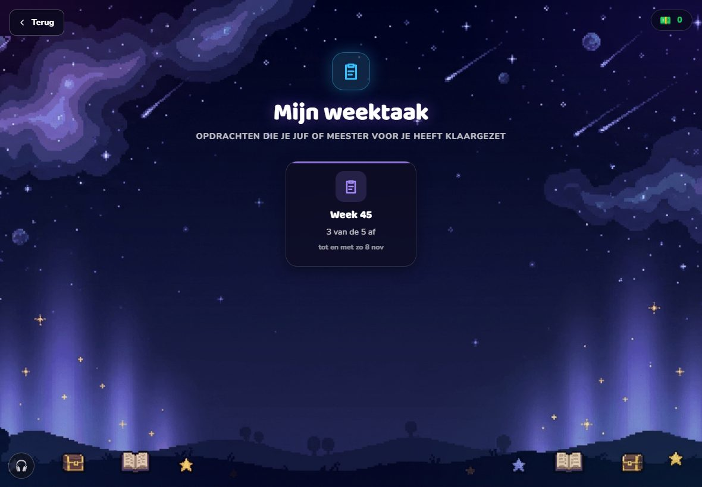

Binnen een weektaak staan de opdrachten. Een groen vinkje betekent af. Bij elke opdracht staat hoe ver de leerling is, bijvoorbeeld "0 / 12 gemaakt" of "Nog 9 min te lezen".

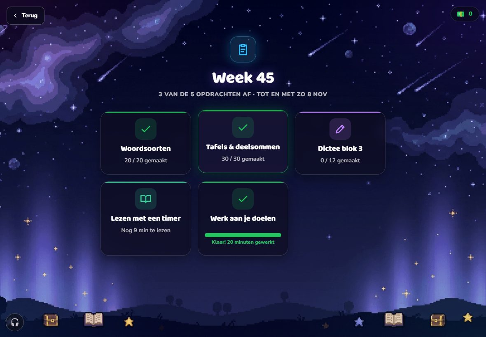

### 12.3 Een oefening maken

De leerling tikt op een opdracht en begint. Bovenaan staat hoeveel er al goed is (het vinkje) en een balkje dat laat zien hoeveel goede antwoorden er nog nodig zijn tot het volgende spelletje. Met **Stoppen** gaat de leerling terug; wat al gemaakt is, blijft bewaard.

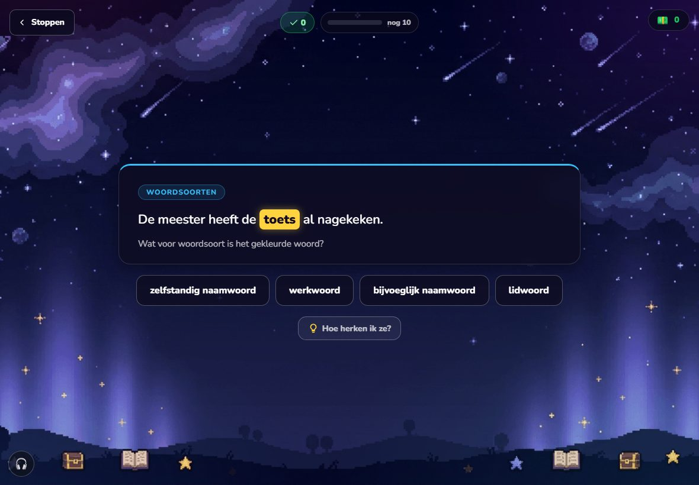

Na elk antwoord ziet de leerling meteen of het goed was, en waarom. Het goede antwoord kleurt groen, een fout antwoord rood.

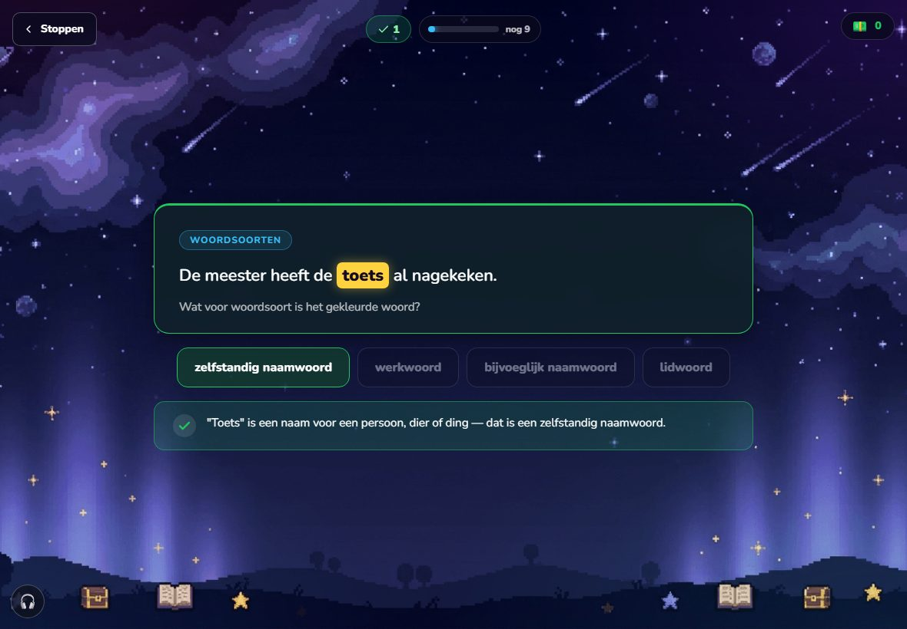

> **Goed om te weten:** bij zinsdelen moet een leerling per stap minstens 5 seconden kijken voordat hij kan nakijken. Zo wordt er minder gegokt.

Rechtsonder staat bij een opgave de knop **Lees voor**. Die leest de vraag, de zin en de uitleg voor met de stem van de iPad of computer. Dat helpt jonge leerlingen en leerlingen met dyslexie. Bij begrijpend lezen en het dictee staat de knop er niet: daar oefen je juist het lezen, en het dictee heeft eigen opnames.

### 12.4 Lezen met een timer

Bij een leesopdracht pakt de leerling zijn boek en tikt op **Start de timer**. De timer loopt door, ook als het scherm uitgaat. Met de pauzeknop of de terugknop stopt de leerling tussendoor; de gelezen minuten blijven bewaard, ook op een andere iPad. De leestaak is pas af als alle minuten gelezen zijn.

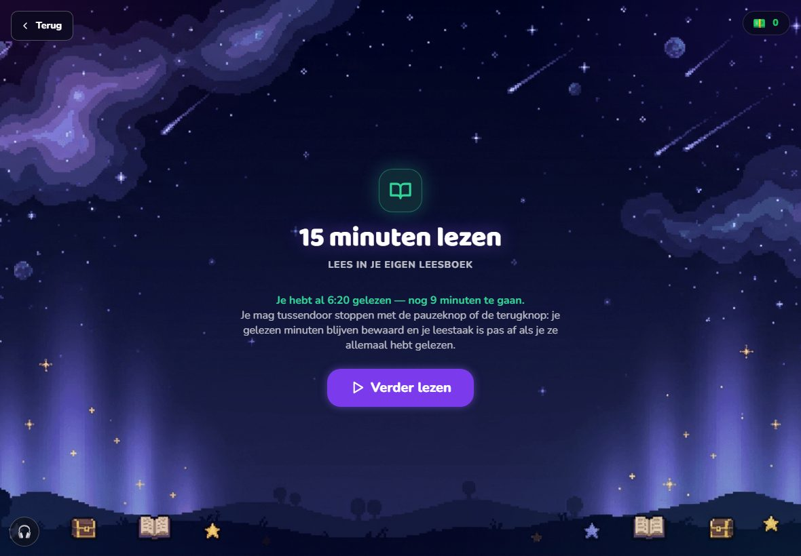

### 12.5 Werk aan je doelen

Bij **Werk aan je doelen** kiest de leerling een van zijn open doelen om aan te werken. Bovenaan staat een balk met de gewerkte minuten. Tijdens het oefenen staat linksonder een klokje met hoeveel minuten er nog over zijn. Alleen echte oefentijd telt, spelletjes niet. Heeft de leerling al zijn doelen behaald, dan kiest hij zelf wat hij oefent.

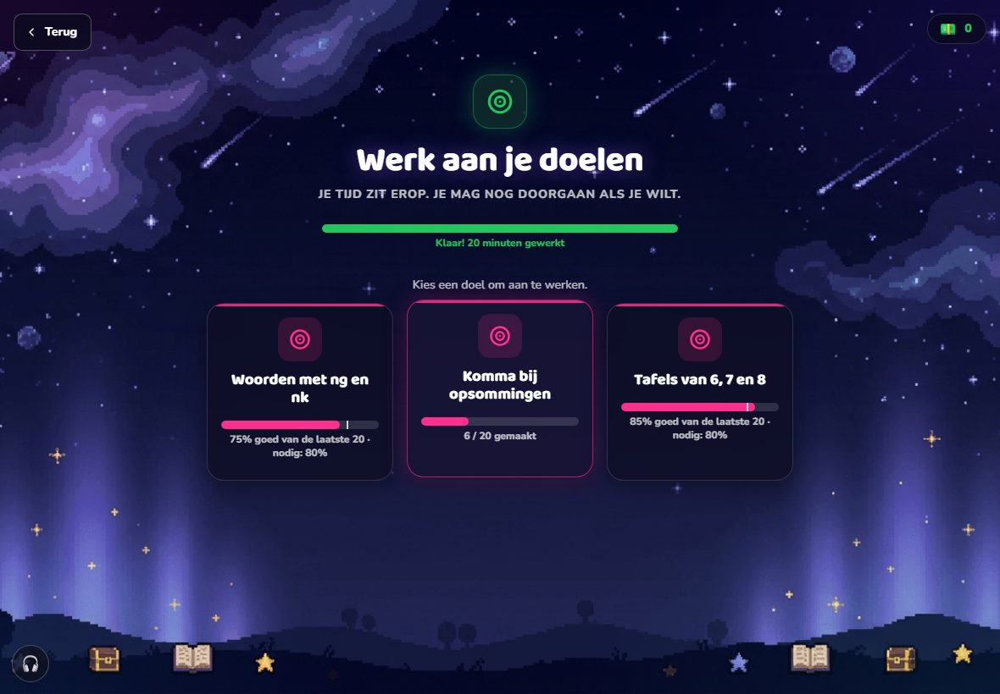

### 12.6 Speciaal voor mij: taken en doelen

Bij **Speciaal voor mij** staan twee knoppen: **Taken** en **Doelen**.

Bij **Taken** staan de taken die de leerling nog moet maken. Een taak verdwijnt als hij af is.

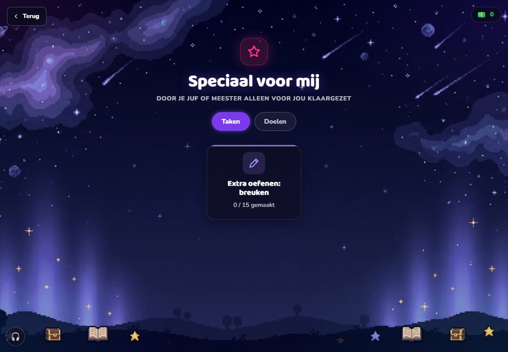

Bij **Doelen** kiest de leerling eerst het vak en daarna het doel.

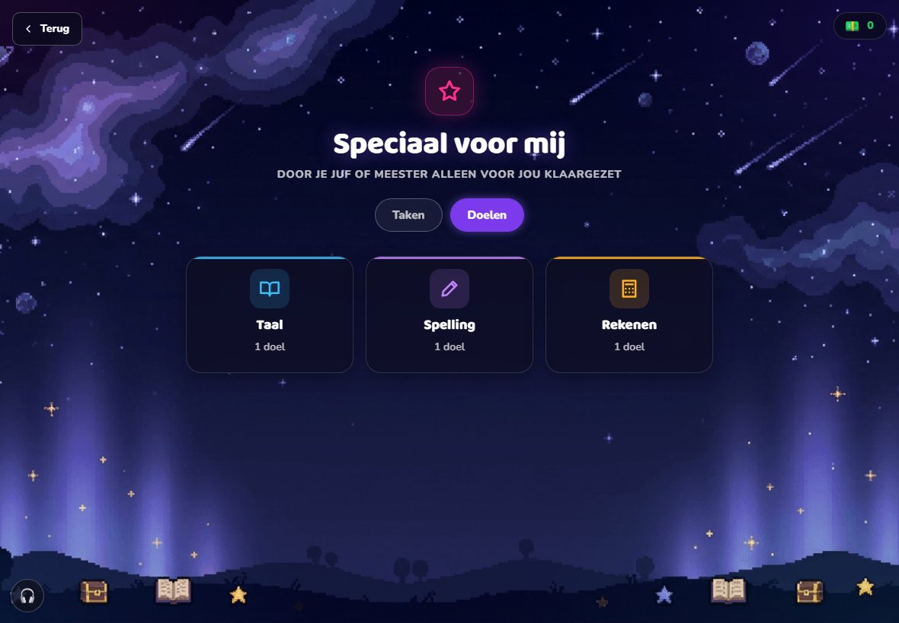

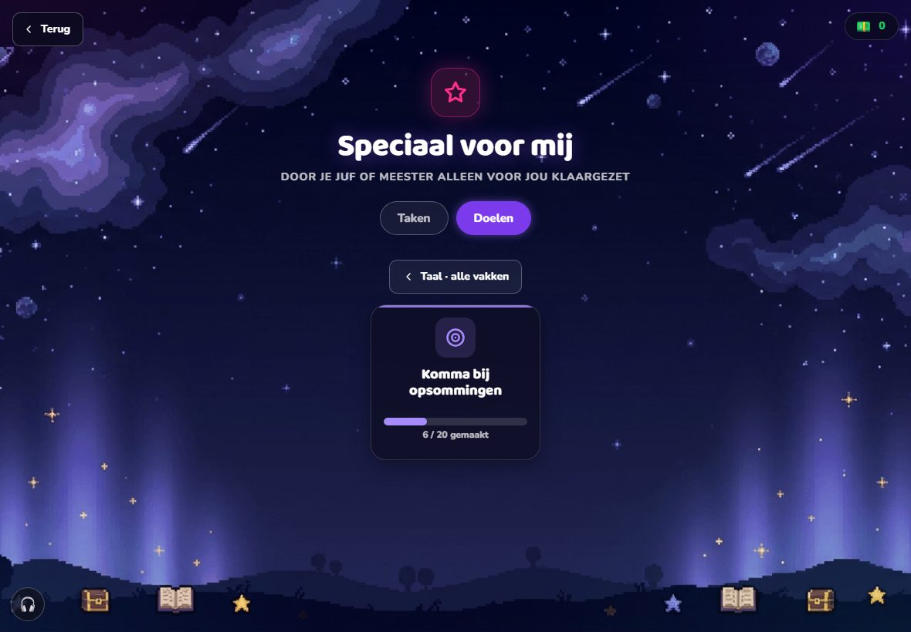

Voor het oefenen ziet de leerling eerst kort hoe het werkt, met een voorbeeld en de balk van het doel.

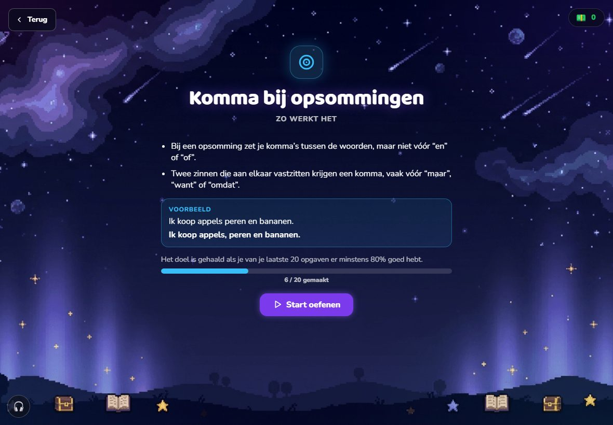

Tijdens het oefenen staat linksonder de **doelbalk**. Eerst telt hij tot 20 opgaven; daarna laat hij het percentage goed van de laatste 20 zien. Bij 80% verschijnt het scherm "Doel behaald!".

Maakt de leerling drie fouten achter elkaar, dan verschijnt eerst **Even uitleg** met de regels en een voorbeeld. Pas na een paar seconden lezen kan de leerling verder.

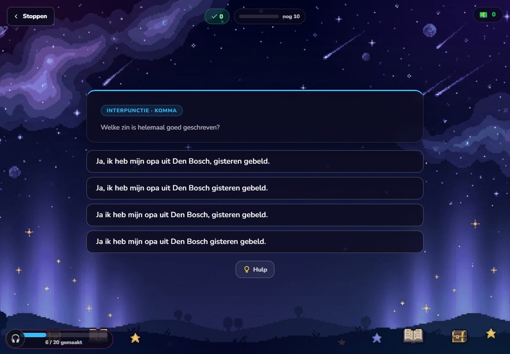

### 12.7 Mijn week

Bij **Mijn week** ziet de leerling wat hij deze week gedaan heeft: het aantal opgaven, het percentage goed, de minuten en de behaalde doelen, verdeeld over weektaak, taken, doelen en vrij oefenen. Met **Bekijk wat je oefende** ziet hij welke opgaven goed en fout gingen.

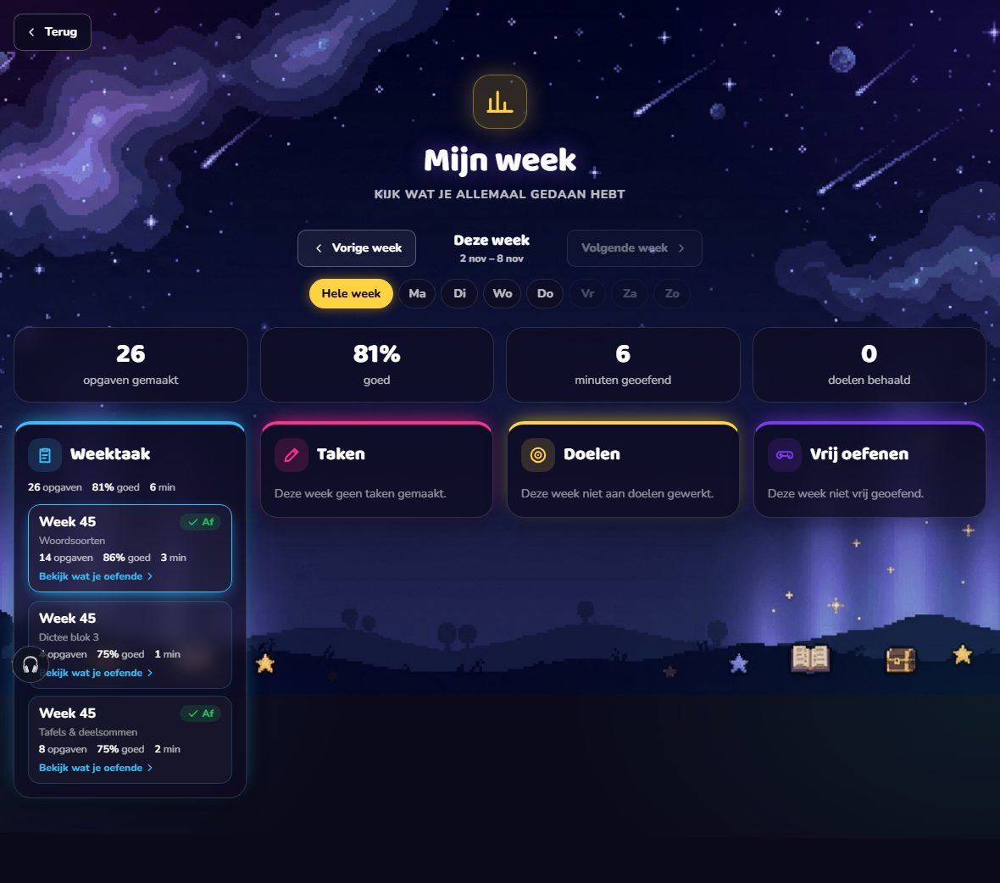

### 12.8 Speel Game en spelletjes als beloning

Bij **Speel Game** kiest de leerling zijn groep en daarna een vak om vrij te oefenen (zie [hoofdstuk 13](#13-vrij-oefenen)). Daaronder staan spelletjes die de leerling vrij mag spelen.

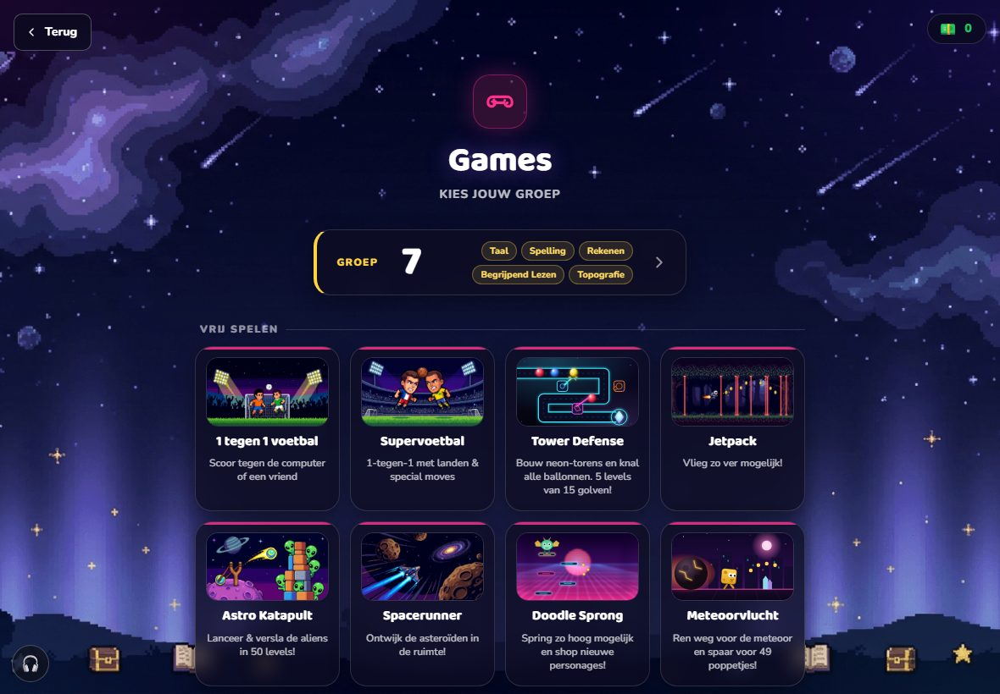

Na een aantal goede antwoorden (standaard 10, bij verhaaltjessommen 5) verschijnt **Goed gedaan!** en kiest de leerling een spelletje als beloning. Een spelletje duurt kort: één ronde, één level of 45 seconden. Daarna gaat de leerling vanzelf verder met oefenen, precies waar hij was. Bij sommige spellen gaat de leerling de volgende keer verder in hetzelfde level.

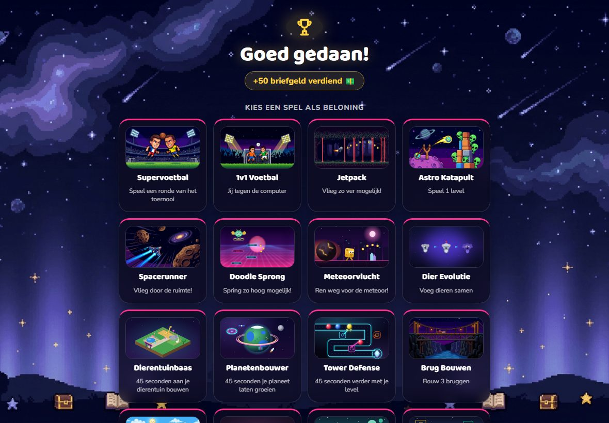

---

## 13. Vrij oefenen

Naast de weektaak, taken en doelen mag een leerling ook **zelf kiezen** wat hij oefent. Dat heet vrij oefenen. Wat de leerling vrij oefent, wordt ook bewaard. Jij ziet het terug in het **Weekoverzicht**, in het vak **Vrij oefenen**.

### Zo werkt het

1. Tik op het startscherm op **Speel Game**.
2. Tik op je **groep** (bijvoorbeeld Groep 7). Bij de groep staan de vakken die er zijn.
3. Kies een **vak**: Taal, Spelling, Rekenen, Begrijpend lezen of Topografie.
4. Kies een **oefening**. Bij elke oefening staat kort wat je oefent, met een voorbeeld.

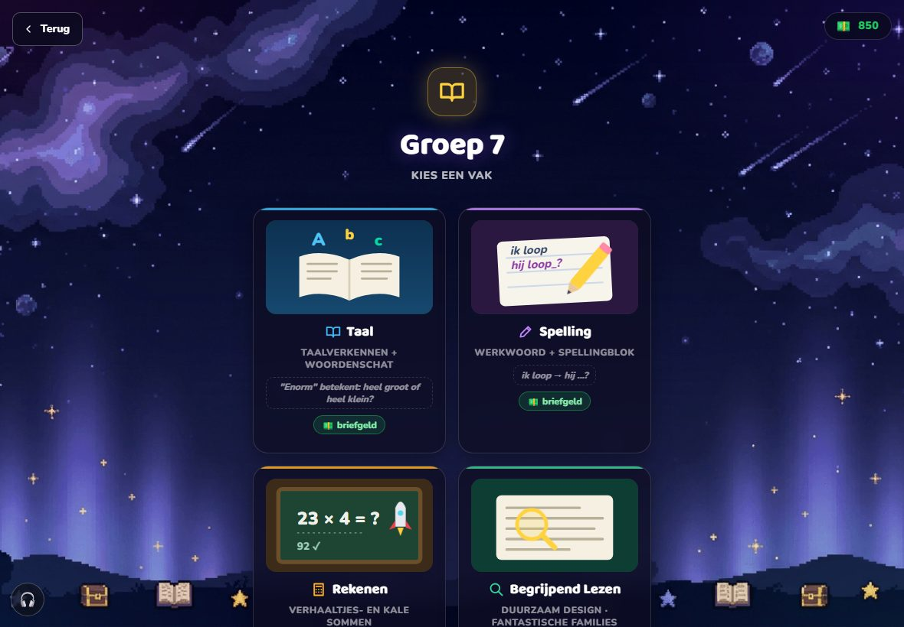

Bij **Rekenen** zie je bijvoorbeeld breuken, maten omrekenen, denkvragen, klokkijken en verhaaltjessommen. Een groen label **briefgeld** betekent dat je met die oefening briefgeld verdient.

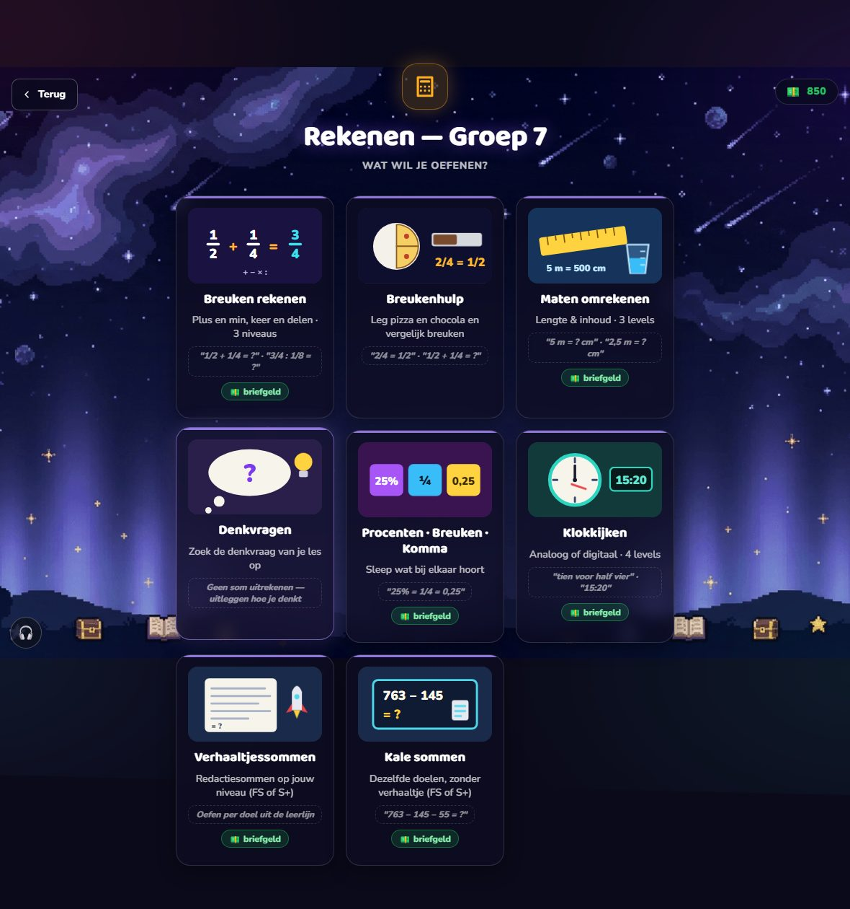

Bij **Taal** kies je eerst een onderdeel: **Taalverkennen** (zinsdelen, woordsoorten, interpunctie en gebiedende wijs) of **Woordenschat**. Ook de **eigen oefeningen** van de leerkracht staan hier, met "Van je juf of meester" eronder.

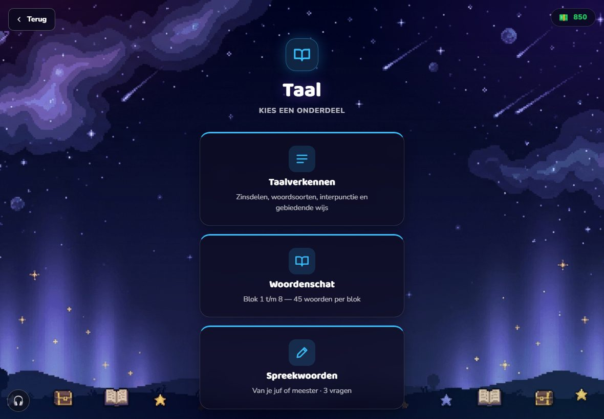

Ook bij vrij oefenen krijgt de leerling na een aantal goede antwoorden een spelletje als beloning, en verdient hij briefgeld.

### Code invoeren

Linksonder op het startscherm staat **Code invoeren**. Hier vult een leerling een code in die hij van de leerkracht krijgt, bijvoorbeeld voor een extra opdracht, een escaperoom of een spel. Je hoeft als leerkracht niets in te stellen: geef de leerling de code en hij tikt hem hier in.

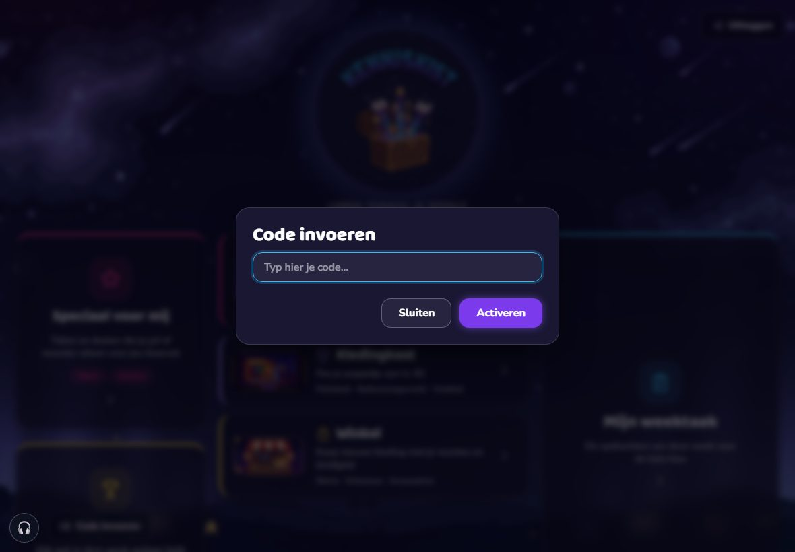

---

## 14. Munten en briefgeld

Kenniskist heeft twee soorten geld. Rechtsboven in beeld ziet de leerling hoeveel briefgeld hij heeft. Hoeveel munten hij heeft, ziet hij in de spelletjes zelf.

| | Hoe verdien je het? | Waar geef je het uit? |
|---|---|---|
| **💵 Briefgeld** | Met **oefenen**: bij elke beloning na een aantal goede antwoorden, met lezen (10 per gelezen minuut) en met het afmaken van een eigen oefening van de leerkracht. | In de **Winkel**: een kist met nieuwe kleding kost 100 briefgeld. |
| **🪙 Munten** | Met de **spelletjes**: goals maken, levels halen, verder komen. | In de spelletjes zelf, bijvoorbeeld voor upgrades, nieuwe wapens of skins. |

Zo is het eerlijk verdeeld: **wie oefent, verdient briefgeld** voor kleding, en wie speelt, verdient munten voor de spelletjes. Een leerling kan dus niet alleen door spelletjes te spelen nieuwe kleding kopen.

Het geld hoort bij het account van de leerling. Het gaat mee naar een andere iPad en blijft bewaard als de leerling uitlogt.

> **Goed om te weten:** het geld is alleen een beloning binnen Kenniskist. Er wordt nooit echt geld gebruikt en er is niets echt te koop.

---

## 15. De winkel en de lootboxen

In de **Winkel** koopt de leerling met briefgeld een **kist** (lootbox) met kleding voor zijn poppetje. Er is een kist voor elk kledingstuk: **Shirt**, **Broek**, **Sokken**, **Schoenen** en **Pet**. Onder elke kist staat hoeveel er al gewonnen is, bijvoorbeeld "3/89".

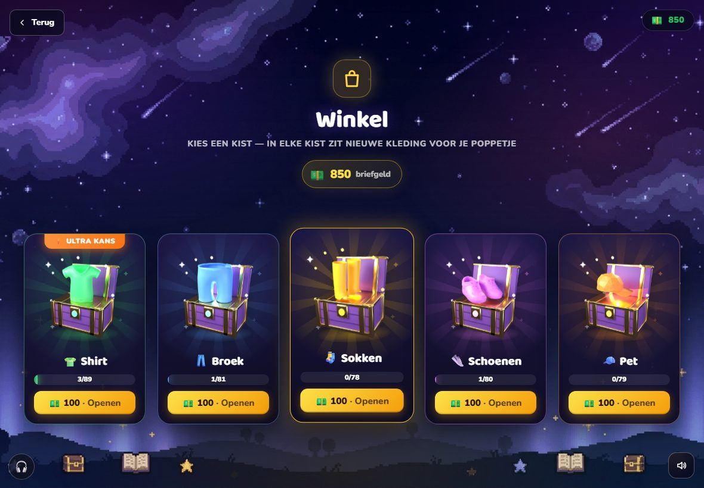

### Wat zit erin?

Tik op een kist. Je ziet dan:

- **De kansen per zeldzaamheid:** Gewoon 34%, Zeldzaam 27%, Episch 20%, Legendarisch 13% en Ultra Legendarisch 6%. Hoe zeldzamer, hoe kleiner de kans. Bij de Shirt-kist staat **ULTRA KANS**: daar zitten ook ultra legendarische shirts in.
- **Je collectie:** welke kleding je uit deze kist al hebt (in kleur) en wat je nog kunt winnen (grijs).
- **De knop 100 · Openen.** Heb je te weinig briefgeld, dan staat er "Te weinig 💵".

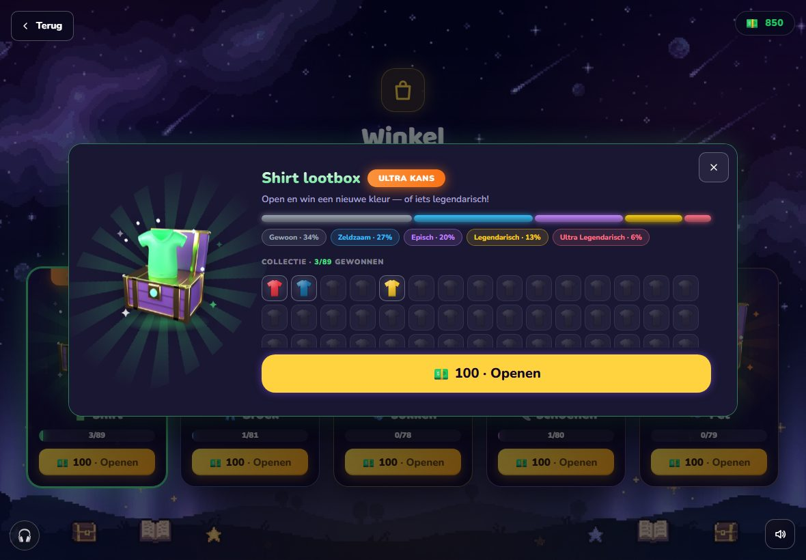

### De kist openen

Na **Openen** verschijnt de kist. De leerling tikt een paar keer op de kist en dan springt hij open: het nieuwe kledingstuk komt eruit, met sterren voor de zeldzaamheid. Een leerling krijgt **nooit iets dubbel**: elke kist geeft iets wat hij nog niet had. Heeft hij alles uit een kist, dan staat er **Compleet**.

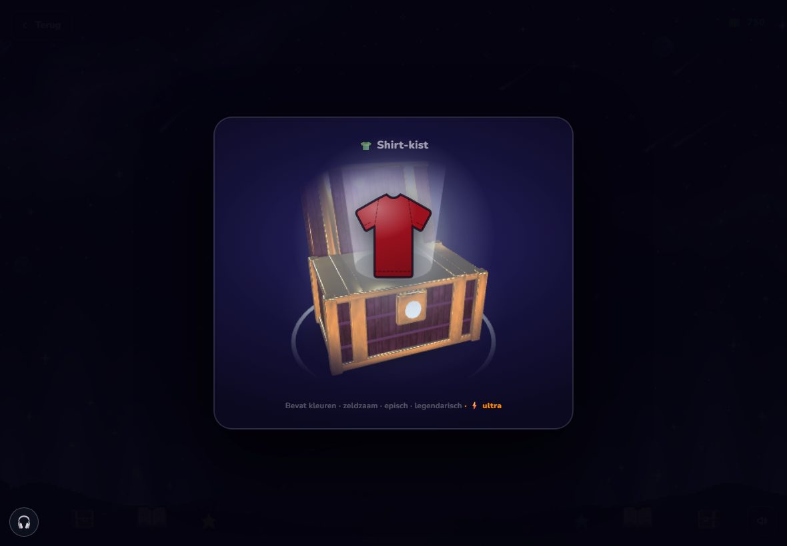

---

## 16. De kledingkast en samen spelen

### De kledingkast

In de **Kledingkast** kleedt de leerling zijn eigen 3D-poppetje aan met de kleding die hij in de winkel heeft gewonnen.

- **Links** staan de soorten kleding: Shirt, Broek, Sokken, Schoenen en Pet, met hoeveel je er al hebt. Een vinkje betekent dat je er een aan hebt.
- Daaronder kies je de **zeldzaamheid** (Alles, Ultra Legendarisch, Legendarisch, Episch, Zeldzaam, Gewoon) en tik je op een kledingstuk om het **aan te trekken**.
- **Verras me!** trekt je in één keer een willekeurige outfit aan.
- **Bovenaan** staan dansjes en bewegingen voor je poppetje: Rust, Hip Hop, Breakdance, Lopen en Verloren.
- Het poppetje draai je rond door erover te slepen.

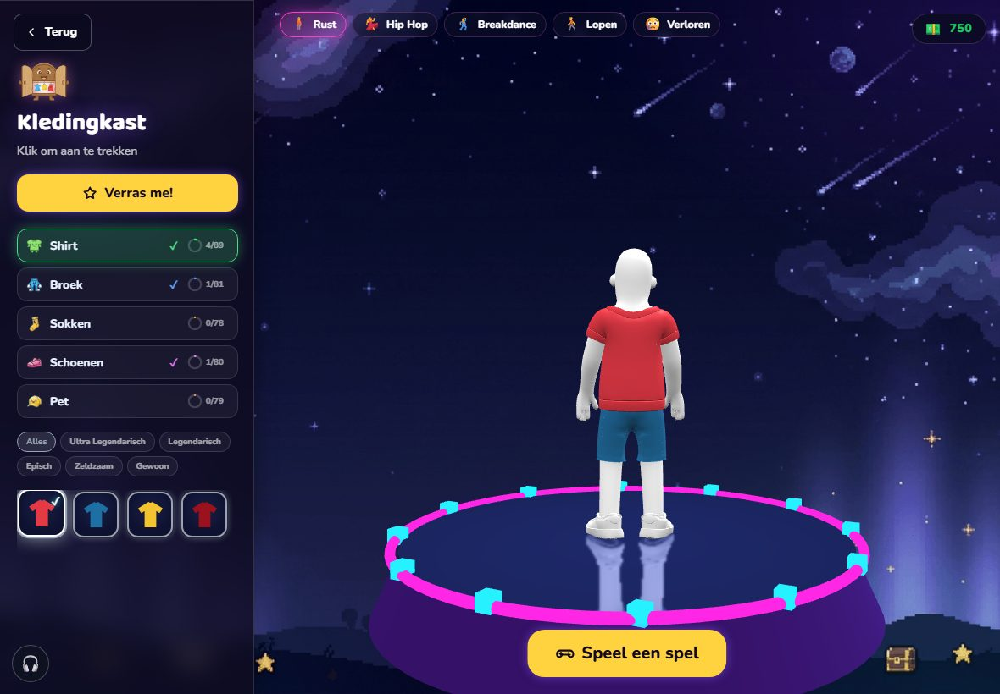

### Samen spelen

Met **Speel een spel** (onderaan) speelt de leerling **met zijn eigen poppetje, in zijn eigen kleding**, een spel samen met klasgenoten: **Voetbal**, **Paintball** of **Ballonnengevecht**.

Zo speel je samen:

1. Eén leerling vult zijn naam in, kiest een veld of map en tikt op **Lobby aanmaken**. Hij krijgt dan een **lobbycode** van een paar cijfers.
2. De anderen kiezen hetzelfde spel, vullen die **lobbycode** in en tikken op **Joinen**.
3. Is iedereen er, dan start het spel. Bij Ballonnengevecht kun je ook computerspelers (bots) toevoegen als er weinig spelers zijn.

> **Goed om te weten:** samen spelen gaat via internet. De eerste keer op een dag kan het verbinden even duren, tot ongeveer een minuut. Alleen leerlingen met dezelfde lobbycode spelen met elkaar, en er wordt niet gechat.

---

## 17. Veelgestelde vragen

**Een leerling kan niet inloggen.**
Controleer de drie gegevens: de klascode (de inlogcode van de klas, zie bovenaan het klasscherm), de gebruikersnaam en het wachtwoord. Weet de leerling het wachtwoord niet meer, reset het dan (zie [hoofdstuk 9](#9-een-leerling-bekijken)).

**Ik zie mijn klas niet.**
Je bent nog niet aan de klas gekoppeld. Vraag de ICT'er om je te koppelen bij de klasinstellingen (zie [4.4](#44-de-instellingen-van-een-klas)).

**Een leerling ziet de weektaak niet.**
Kijk of de startdatum al begonnen is en de einddatum nog niet voorbij is, en of de leerling bij **Voor wie?** aangevinkt staat. Controleer ook of de opdracht bij **Alleen niet af** niet op "hoeft niet" staat.

**Gaat het werk verloren als een leerling op een andere iPad verdergaat?**
Nee. Het gemaakte werk, de munten, de leestimer en de spelletjes worden bewaard bij het account van de leerling. Laat leerlingen op een gedeeld apparaat wel altijd uitloggen.

**Kan een leerling gokken?**
Kenniskist laat zien hoeveel er goed is, niet alleen hoeveel er gemaakt is. Bij doelen telt alleen 80% goed van de laatste 20 opgaven. Bij zinsdelen moet een leerling per stap even kijken voordat hij kan nakijken. En na drie fouten op rij krijgt de leerling eerst uitleg.

**Kunnen spelletjes uit?**
Ja. Op het tabblad **Leerlingen** stel je per klas in hoe vaak er een spelletje komt, of zet je ze helemaal uit.

**Kan een leerling met spelletjes zijn kleding verdienen?**
Nee. Kleding koop je met briefgeld, en briefgeld verdien je alleen met oefenen. In spelletjes verdien je munten, die je in de spelletjes zelf uitgeeft (zie [hoofdstuk 14](#14-munten-en-briefgeld)).

**Kost Kenniskist of de winkel echt geld?**
Nee. Munten en briefgeld zijn alleen een beloning binnen Kenniskist. Er wordt nooit om echt geld gevraagd.

**Met wie spelen leerlingen samen?**
Alleen met wie dezelfde lobbycode invult. Meestal spreek je dat in de klas af: één leerling maakt een lobby en noemt de code (zie [hoofdstuk 16](#16-de-kledingkast-en-samen-spelen)).

**Wat gebeurt er aan het eind van het schooljaar?**
De ICT'er maakt de nieuwe klassen aan en schuift de leerlingen door (zie [4.4](#44-de-instellingen-van-een-klas)). Het gemaakte werk en de munten gaan mee. Daarna kan de oude klas verwijderd worden.

---

## 18. Uitlegfilmpjes

Liever kijken dan lezen? Deze korte filmpjes laten stap voor stap zien waar je op klikt. Elk filmpje heeft ondertitels, dus je kunt ze ook zonder geluid bekijken.

### Voor de leerkracht en de ICT'er

@film 1-inloggen-en-je-klas | Inloggen en je klas | Inloggen, het leerkrachtenportaal en je klas.
@film 2-leerlingen-toevoegen | Leerlingen toevoegen | Leerlingen aan je klas toevoegen en de inloggegevens uitdelen.
@film 3-weektaak-klaarzetten | Een weektaak klaarzetten | Opdrachten voor de hele klas klaarzetten.
@film 4-voortgang-volgen | De voortgang volgen | Zien wie wat heeft gedaan, per leerling en per opdracht.
@film 5-taken-en-doelen | Taken en doelen | Een taak of een doel voor één leerling.
@film 6-voor-de-icter | Voor de ICT'er | Klassen, leerkrachten en leerlingen voor de hele school.

### Voor de leerling

Deze filmpjes kun je ook in de klas laten zien.

@film 7-zo-werkt-het-voor-de-leerling | Zo werkt het voor de leerling | Inloggen, de weektaak en oefenen.
@film 8-vrij-oefenen | Vrij oefenen | Zelf kiezen wat je oefent, en een code invoeren.
@film 9-munten-briefgeld-en-de-winkel | Munten, briefgeld en de winkel | Wat verdien je waarmee, en een kist openen.
@film 10-kledingkast-en-samen-spelen | De kledingkast en samen spelen | Je poppetje aankleden en samen een spel spelen.
